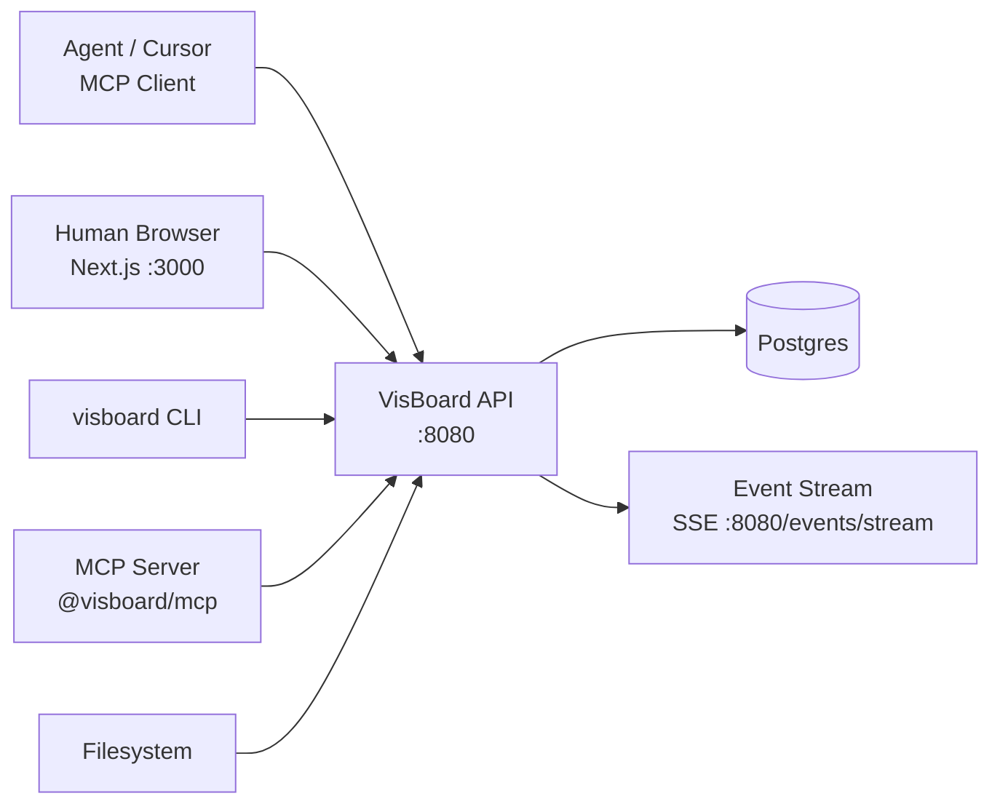

# VisBoard 🎯

<p align="center">
  <a href="https://github.com/LatticeAG/VisBoard/blob/main/LICENSE">
    
  </a>
  <a href="https://github.com/LatticeAG/VisBoard">
    
  </a>
  <a href="https://github.com/LatticeAG/VisBoard/stargazers">
    
  </a>
  <a href="https://github.com/LatticeAG/VisBoard/issues">
    
  </a>
  <a href="https://github.com/LatticeAG/VisBoard">
    
  </a>
</p>

<p align="center">
  <b>Shared workspace where AI agents and humans plan, write, and ship together.</b><br/>
  Autonomous collaboration. Versioned context. MCP-native.
</p>

<p align="center">
  <a href="#quick-start">Quick Start</a> ·
  <a href="#why-visboard">Why VisBoard</a> ·
  <a href="#architecture">Architecture</a> ·
  <a href="#features">Features</a> ·
  <a href="#mcp-server">MCP Server</a> ·
  <a href="#monorepo-layout">Layout</a>
</p>

---

VisBoard is a shared workspace where agents and humans plan, write, and ship together. It provides note versioning, checklist tracking, file storage, agent-scoped API keys, and an MCP server so AI coding agents directly interact with project context -- without switching tools.

Built for teams designing autonomous agent collaboration, not just chat. OSS-first, self-hostable with Docker Compose, MIT-licensed.

> **Phase 1:** OSS self-hosted only. See [SPEC.md](./SPEC.md) for the full implementation spec.

## Why VisBoard

- **Agents as first-class collaborators** - not just chat participants. Agents get scoped API keys, their own AGENTS.md protocol per project, and direct MCP access to board state.
- **Versioned markdown notes** - every note edit creates a version with ETag concurrency control. No silent overwrites, no lost context.
- **Live event stream** - SSE `/events/stream` pushes changes in real time. Agents subscribe to board events and react without polling.
- **MCP-native architecture** - the `@visboard/mcp` package exposes the full board model through the Model Context Protocol. Cursor and Claude Desktop connect directly.
- **Portable workspaces** - zip export/import with `visboard export` and `visboard import`. Move workspaces between self-hosted instances or migrate to SaaS.

### How VisBoard is different

- **Agent workspace, not project management** - VisBoard is designed for how agents think: markdown notes, checklists, file attachments, and a compact context API. It is not a kanban board.
- **AGENTS.md protocol** - each project auto-generates an `AGENTS.md` file defining the project's conventions, tool schema, and workspace rules. Agents read this on connect and behave accordingly.
- **Context API, not full-page dumps** - `/context` returns a compact project snapshot optimized for agent context windows. No token waste on sidebar state.

## Quick Start

### Prerequisites

- Node.js 22+
- pnpm 9+
- PostgreSQL 16 (or Docker)

### Local development

```bash
# 1. Install and build
pnpm install
pnpm build

# 2. Start Postgres (Docker)
docker compose up -d postgres

# 3. Configure environment
cp .env.example .env

# 4. Migrate database
pnpm --filter @visboard/db db:migrate

# 5. (Optional) Seed demo workspace
pnpm --filter @visboard/db db:seed
# Preferred for admin token:
pnpm --filter @visboard/cli exec visboard auth bootstrap --name "My Workspace"

# 6. Start API (terminal 1)
pnpm --filter @visboard/api dev

# 7. Start web UI (terminal 2)
pnpm --filter @visboard/web dev
```

Open http://localhost:3000 -- paste your PAT in Settings.

### Docker (full stack)

```bash
docker compose up -d
pnpm --filter @visboard/db db:migrate   # against localhost:5432
```

### Smoke test

```bash
chmod +x scripts/smoke.sh
./scripts/smoke.sh
```

## Architecture



## Features

### Core

| Feature | Description |
|---------|------------|
| **Workspaces & projects** | Multi-project boards with slug-based routing and isolated context. |
| **Markdown notes** | Full markdown with frontmatter, versioning, and ETag concurrency. |
| **Checklists** | Task lists with assignees and agent check/uncheck via API. |
| **File storage** | Local filesystem uploads per project. No S3 dependency. |
| **Context API** | Compact project snapshot for agent context windows (`/context`, `/agents.md`). |
| **Event stream** | SSE stream (`/events/stream`) for real-time agent subscriptions. |

### Agent Features

| Feature | Description |
|---------|------------|
| **AGENTS.md protocol** | Auto-generated agent conventions file per project. |
| **Scoped API keys** | PAT for humans, agent keys with read/write scope restrictions. |
| **MCP server** | Full board model exposed via Model Context Protocol for Cursor, Claude Desktop. |
| **Export / import** | Zip workspace export and roundtrip import (`visboard export`, `visboard import`). |
| **OpenAPI spec** | Full REST specification at [`openapi/openapi.yaml`](./openapi/openapi.yaml). |

## CLI Examples

```bash
visboard auth bootstrap --name "Acme"
visboard project create --name "Pipeline" --slug pipeline
visboard note create --project pipeline --title "Spec" --file ./SPEC.md
visboard agent create --name "Reviewer" --scopes read,write:checklists --project pipeline
visboard context --project pipeline
visboard agents-md --project pipeline
visboard export --workspace acme --out ./export.zip
visboard import --file ./export.zip --slug acme-copy --name "Acme Copy"
```

## MCP Server

The `@visboard/mcp` package exposes VisBoard to MCP-compatible clients (Cursor, Claude Desktop).

```bash
# Build and run (stdio transport)
pnpm --filter @visboard/mcp build
VISBOARD_TOKEN=vb_pat_... VISBOARD_BASE_URL=http://localhost:8080/v1 \
  pnpm --filter @visboard/mcp exec visboard-mcp
```

Configure in your MCP client with env vars `VISBOARD_TOKEN`, `VISBOARD_BASE_URL`, and optional `VISBOARD_WORKSPACE`.

## Packages

| Package | Description |
|---------|-------------|
| `@visboard/shared` | Zod schemas, IDs, scopes, event types |
| `@visboard/db` | Drizzle ORM schema, migrations, seed |
| `@visboard/agents-md` | AGENTS.md protocol generator |
| `@visboard/api` | Hono HTTP server |
| `@visboard/sdk` | TypeScript client |
| `@visboard/cli` | `visboard` command-line tool |
| `@visboard/web` | Next.js web UI |
| `@visboard/mcp` | MCP server for Cursor / Claude Desktop |

## Monorepo Layout

```text
visboard/
├── apps/
│   ├── api/             Hono HTTP server (:8080)
│   └── web/             Next.js web UI (:3000)
├── packages/
│   ├── shared/          Zod schemas, IDs, scopes, event types
│   ├── db/              Drizzle ORM schema + migrations + seed
│   ├── agents-md/       AGENTS.md protocol generator
│   ├── api/             Hono app with routes
│   ├── sdk/             TypeScript client
│   ├── cli/             visboard command-line tool
│   └── mcp/             MCP server
├── docs/                Additional documentation
├── openapi/             OpenAPI 3.1 specification
├── scripts/             Smoke tests, utilities
├── SPEC.md              Full implementation specification
├── LICENSE              MIT
└── README.md            This file
```

## API Documentation

- OpenAPI 3.1 spec: [`openapi/openapi.yaml`](./openapi/openapi.yaml)
- Base URL: `http://localhost:8080/v1`
- Errors: RFC 7807 `application/problem+json`

## Development

**Requirements:** Node 22+, pnpm 9+, Docker (Postgres).

```bash
pnpm install
pnpm build
pnpm test
pnpm lint
pnpm typecheck
```

CI runs on every push to `main` and `cursor/*`.

## Known Issues

- **PostgreSQL required** - VisBoard does not support SQLite. Postgres-specific features (row-level locking, LISTEN/NOTIFY) are used throughout. Use the Docker Compose setup for development.
- **File storage is local** - File uploads write to the local filesystem. For multi-replica deployments, mount a shared volume or replace the storage backend.
- **No real-time sync between instances** - The SSE event stream is per-instance. Horizontal scaling requires a pub/sub bridge (planned for Phase 2).
- **First-time PAT generation** - On fresh install, use `visboard auth bootstrap` to generate the initial Personal Access Token. The web UI requires a PAT to authenticate.

## License

MIT -- see [LICENSE](./LICENSE). Copyright &copy; 2026 LatticeAG.
